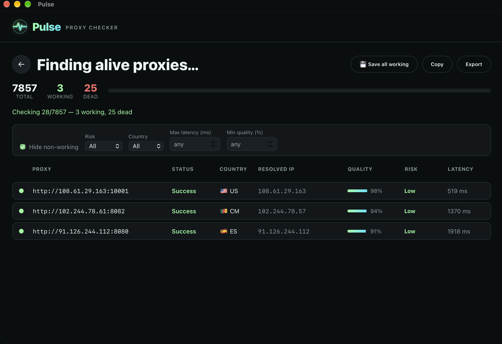
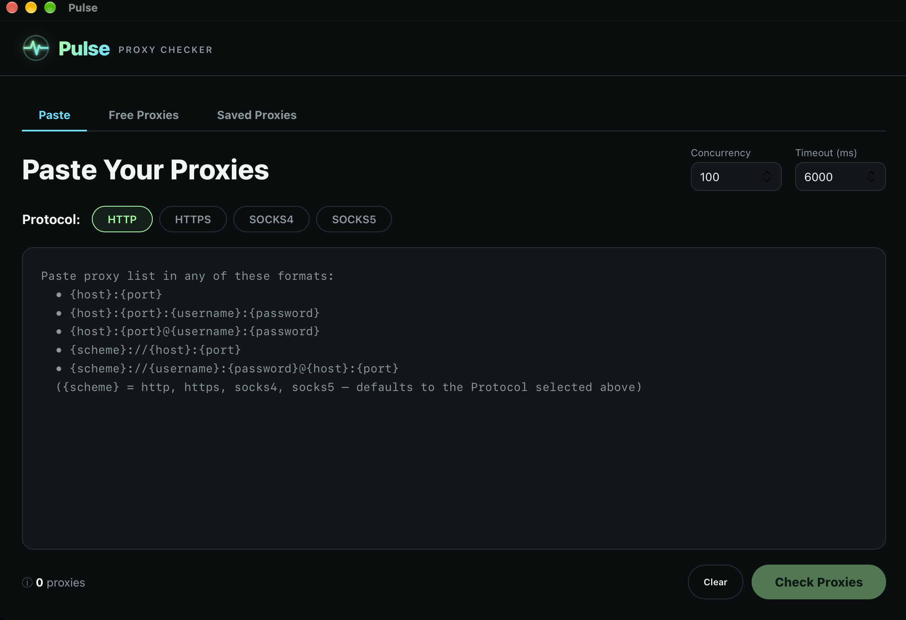
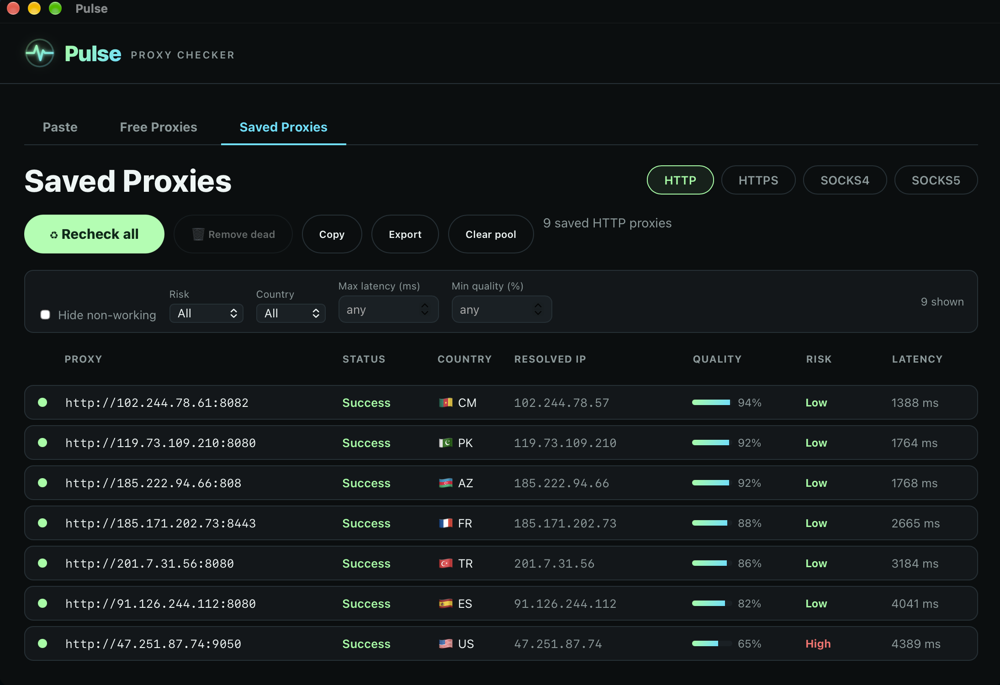

<div align="center">

# ⚡ Pulse — Proxy Checker

**A fast, local, open-source desktop proxy checker.**

Check HTTP / HTTPS / SOCKS4 / SOCKS5 proxies, pull fresh ones from public lists, and
keep a maintained pool of your working proxies — with live results, country / quality /
risk data, and **zero API rate limits**.

[](../../releases)
[](../../stargazers)
[](LICENSE)
[](../../releases)
[](https://tauri.app)
[](#contributing)



</div>

---

## About

**Pulse** is a free, open-source **proxy checker** and **proxy tester** for the
desktop. Paste a proxy list — or let Pulse **scrape thousands of free proxies** from
public sources — and it verifies which are alive across **HTTP, HTTPS, SOCKS4 and
SOCKS5**, streaming results live. Every working proxy is enriched with its **country,
resolved exit IP, ISP/ASN, a quality score, and a risk rating** — all computed
**locally** from a bundled GeoIP database, so there are **no API keys and no rate
limits**. Keep a curated **pool of working proxies** per protocol, recheck it anytime,
filter by risk/country/latency/quality, and export the results.

Built with **Tauri + Rust** (native, lightweight) and a **Node.js** checking engine.
Runs on **macOS and Windows**. MIT licensed.

> **Keywords:** proxy checker · proxy tester · proxy validator · proxy scraper ·
> free proxy list · HTTP/HTTPS/SOCKS4/SOCKS5 proxies · proxy pool · bulk proxy checker

## Features

- **Three modes** — Paste your own, find **Free Proxies** from public lists, or manage a **Saved** pool.
- **4 protocols** — HTTP, HTTPS, SOCKS4, SOCKS5.
- **Free proxy finder** — pulls thousands of fresh proxies per protocol from public lists and checks which are alive, streaming results **live**.
- **Rich results** — resolved exit IP, country (with flag), quality %, and risk level for every working proxy — all computed **locally** from a bundled IP database. No third-party scoring API, **no rate limits**.
- **Filters** — risk, country, max latency, min quality. Copy / Export / Save respect the active filters.
- **Saved pools** — save working (or filtered) proxies into a persistent per-protocol pool. Recheck anytime, prune dead ones, copy or export.
- **Export** — writes a timestamped `proxies-<scheme>-<date>.txt`.
- **Fully self-contained** — the desktop app bundles everything; end users need nothing installed.

<table>
<tr>
<td width="50%"></td>
<td width="50%"></td>
</tr>
<tr>
<td align="center"><em>Paste &amp; check any list</em></td>
<td align="center"><em>Maintained saved pool, per protocol</em></td>
</tr>
</table>

## Download

Grab the latest build for your platform from the [**Releases**](../../releases) page:

- **macOS** — `Pulse_x.y.z_aarch64.dmg`
- **Windows** — `Pulse_x.y.z_x64-setup.exe`

> macOS builds are unsigned — on first launch, right-click the app → **Open**
> (or allow it under *System Settings → Privacy & Security*).

## How it works

Pulse is a **Tauri (Rust)** desktop shell with a **Node.js** checking engine and a
**Vite** frontend. For each proxy the engine:

1. connects **through the proxy** to lightweight IP-echo endpoints (rotating, with
   fallback) to confirm it actually forwards traffic and read its **exit IP**;
2. geolocates the exit IP **locally** against a bundled DB-IP Lite database
   (country, ISP, ASN) — no API calls, no limits;
3. computes a **quality %** (latency + anonymity + datacenter detection) and a
   **risk** rating (Low / Medium / High).

## Build from source

Requirements: **Node 18+**, **Rust (stable)**, and the
[Tauri prerequisites](https://v2.tauri.app/start/prerequisites/) for your OS.

```bash
# engine
cd host && npm install && npm test

# frontend
cd ../ui && npm install && npm run build

# desktop app (dev)
cd ../src-tauri && cargo tauri dev
```

To produce a release bundle:

```bash
cd host && npm run pkg                        # self-contained engine binary
cp host/dist/PulseEngine src-tauri/assets/    # stage it as a resource
cd src-tauri && cargo tauri build             # -> .dmg / .exe
```

## Project layout

```
├─ host/          Node.js checking engine (+ bundled GeoIP data)
├─ src-tauri/     Rust / Tauri shell (commands, persistence, window)
├─ ui/            Vite frontend
└─ .github/workflows/release.yml   CI — builds macOS + Windows on a version tag
```

## Releasing

Pushing a version tag triggers CI, which builds the macOS `.dmg` and Windows `.exe`
and attaches them to a GitHub Release:

```bash
git tag v1.0 && git push origin v1.0
```

## Contributing

**Contributions are very welcome!** 🎉 Bug fixes, new proxy-list sources, better
quality/risk heuristics, UI polish, docs — PRs of all sizes are appreciated.

1. Fork the repo and create a branch: `git checkout -b my-feature`
2. Make your change, keep the existing style, and run `cd host && npm test`
3. Open a pull request describing **what** and **why**

Found a bug or have an idea? [Open an issue](../../issues).

## GeoIP data & attribution

Country / ISP / ASN lookups use the **[DB-IP Lite](https://db-ip.com/db/lite.php)**
databases (`host/data/*.mmdb`), refreshable monthly. They are licensed under
**[CC BY 4.0](https://creativecommons.org/licenses/by/4.0/)** — free to use and
redistribute (including commercially) **with attribution**. Pulse displays the
required *"IP Geolocation by DB-IP"* credit in the app UI.

> IP Geolocation by DB-IP — <https://db-ip.com>

See [NOTICE.md](NOTICE.md) for full third-party notices.

## Proxy sources & credits

The **Free Proxies** finder pulls public proxy lists at runtime from these
community-maintained projects — huge thanks to their authors:

| Source | Author | License |
|--------|--------|---------|
| [PROXY-List](https://github.com/TheSpeedX/PROXY-List) | TheSpeedX | credit requested |
| [proxy-list](https://github.com/monosans/proxy-list) | monosans | MIT |
| [free-proxy-list](https://github.com/proxifly/free-proxy-list) | Proxifly | GPLv3 |
| [proxy-list](https://github.com/jetkai/proxy-list) | jetkai | MIT |
| [ProxyScrape API](https://proxyscrape.com) | ProxyScrape | free tier |

Pulse **fetches these lists live and discards them after checking** — it does not
bundle, store, or redistribute any provider's proxy data.

## Privacy

All checking happens on your machine. The only network traffic is: fetching public
proxy lists, the proxy connections you ask it to test, and lightweight IP-echo
lookups to read each proxy's exit IP.

## License

Pulse's source code is [MIT](LICENSE) — free to use, modify, and distribute.

The bundled DB-IP Lite geolocation data is a separate work under
[CC BY 4.0](https://creativecommons.org/licenses/by/4.0/) (attribution required) —
see [NOTICE.md](NOTICE.md). MIT covers the code, not the data.
